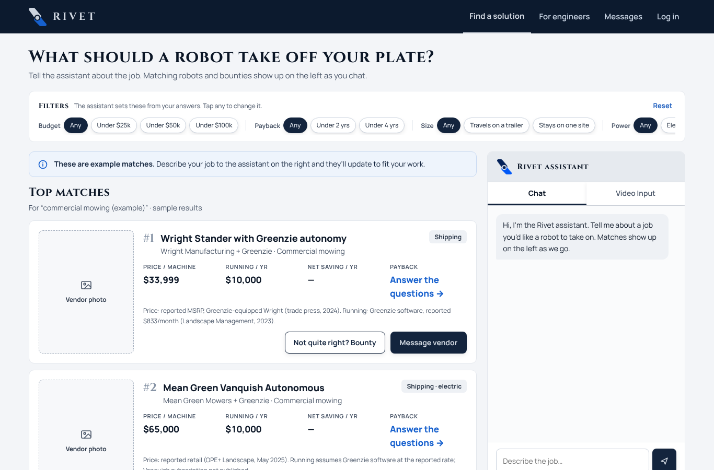
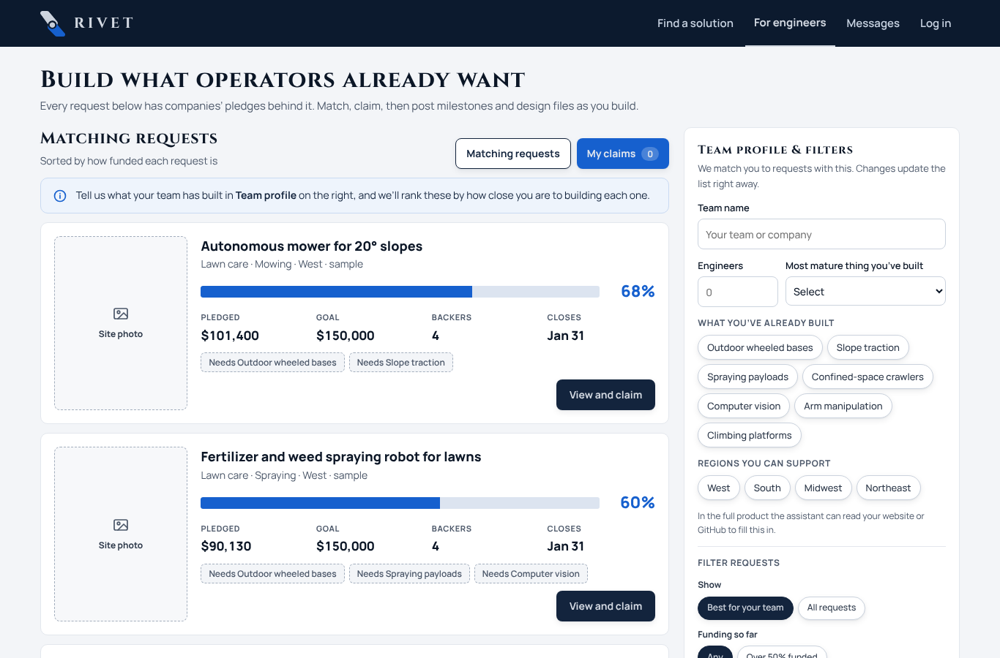

<div align="center">

# Rivet

**Robotics procurement for small trade businesses — describe the job, get ranked robots with the payback worked out in code, and pool demand for the robots that don't exist yet.**

[](https://github.com/danielwork12121-lab/Rivet/actions/workflows/ci.yml)
[](https://rivet-rose.vercel.app)
[](hackathon.md)

[Live demo](https://rivet-rose.vercel.app) · [How it works](#how-it-works) · [Architecture](#architecture) · [Run it locally](#run-it-locally) · [Docs](docs/)

</div>

---

## Why

Small blue-collar operators — landscapers, property managers, cleaning and maintenance crews — know exactly which jobs are dangerous, repetitive or impossible to staff. What they don't have is an engineer to translate "clear weeds out of a wetland pond" into robot specs, a way to tell marketing ROI from real ROI, or the purchasing power to get a fair price. Robotics startups have the opposite problem: hardware that works, and no idea which operators would buy it.

Rivet sits between the two:

1. **Describe the job** in plain words, a site video, or the spreadsheet you already keep.
2. **Get ranked robots** whose fit, evidence and payback are computed deterministically from vendor-page specs — not from an LLM's opinion.
3. **Buy together.** Verified demand is pooled so operators get volume pricing and vendors get committed orders.
4. **Post a bounty** when nothing fits. Operators with the same gap co-fund it; robotics teams claim it with validated customers already waiting.

## Screenshots

| Find a solution | For engineers (live bounty board) |
| --- | --- |
|  |  |

## How it works

```
 operator input                       Rivet                                        output
 ─────────────            ───────────────────────────────────            ─────────────────────
 text / chat   ─┐                                                          ranked robots
 site video    ─┼─▶  intake  ─▶  workflow breakdown  ─▶  requirements  ─▶  (score 0–100,
 spreadsheet   ─┘   (Claude,       (3–7 steps,           (must-haves,       payback, 5-yr value,
                     Gemini)        which a robot         budget, env.)      evidence quotes)
                                    could do)                  │
                                                               ▼                 ▼
                                         catalog  ◀──  Apify robot-spec-finder   pooled bounty
                                      (vendor-page       (search → verify →       if nothing fits
                                       specs w/ quotes)   extract specs)
```

**Deterministic where it matters.** LLMs handle language: splitting a job into steps, reading a video, drafting a spec. Everything the operator will spend money on is plain code with tests:

- **Fit gate** — a robot that misses any checkable must-have (outdoor rating, slope, payload, power) scores 0, full stop. `convex/lib/decide.ts`
- **Score** `S = F · (0.4·Cost + 0.3·Requirements + 0.3·Evidence)` — cost fit from payback, requirement coverage, and how much of what we're judging on was actually read from the vendor's page. `convex/lib/score.ts`
- **ROI / TCO / payback / 5-year value** — computed, not generated, and a robot with an unverified labor-share number can never reach a perfect evidence score. `convex/lib/roi.ts`
- **Provenance on every pick** — `vendor_sourced` (with the quoted sentence and URL), `unverified`, or `fictional_sample` for demo data, shown to the user as such.

**Catalog from the open web.** The [`robot-spec-finder`](apify/robot-spec-finder/) Apify actor searches for robots matching a task, verifies the page is a real product, extracts specs with source quotes, and writes rows the matcher can score.

**Pooled bounties.** When no robot clears the gate, the request becomes a bounty. Pledges from operators with the same job accumulate toward a goal; the engineer board subscribes to Convex and updates live as pledges land.

## Architecture

```
pages/*.html  ─── plain HTML/JS, no framework ───┐
js/rivet-*.js    (config, Clerk auth, Convex client)│
                                                    ▼
Vercel ──── api/*.js (serverless)         Convex (realtime backend)
            ├─ chat.js        Claude      ├─ schema.ts     15 tables, 22 indexes
            ├─ analyze-video  Gemini      ├─ requests/matching/bounties/robots
            └─ analyze-excel  Claude      ├─ agent.ts + ai.ts   scheduled internal actions
                                          ├─ lib/{decide,score,roi,specs,pool}  pure logic
                                          ├─ lib/aiBudget.ts    per-day spend caps
                                          ├─ discovery/scrape   → Apify actor
                                          └─ crons.ts           stuck-work sweeper (2 min)
```

| Layer | Choice | Why |
| --- | --- | --- |
| Backend | [Convex](https://convex.dev) | One place for data, auth checks, scheduled AI work and live subscriptions; owner-only access enforced inside every function via `ctx.auth`. |
| Auth | Clerk | Separate Client / Developer roles; tokens verified server-side. |
| Reasoning | Claude (Haiku → Sonnet → Opus by task) | Workflow breakdown, spec drafting, chat. Budgeted per user/day before any paid call. |
| Vision | Gemini | Site-video analysis: objects, motion, spatial constraints. |
| Catalog | Apify actor (TypeScript) | Reproducible, rate-limited web discovery of vendor specs with quotes. |
| Frontend | Static HTML + vanilla JS on Vercel | Zero build step; `scripts/check-frontend.mjs` compiles every page in CI. |

More detail: [docs/matching.md](docs/matching.md) · [docs/intake-integration.md](docs/intake-integration.md) · [docs/excel-intake-integration.md](docs/excel-intake-integration.md) · [docs/accounts-and-access.md](docs/accounts-and-access.md) · [docs/deploy.md](docs/deploy.md)

## Run it locally

```bash
git clone https://github.com/danielwork12121-lab/Rivet && cd Rivet
npm install
cp .env.example .env.local
npx convex dev            # creates a dev deployment and writes CONVEX_DEPLOYMENT/CONVEX_URL
```

Then serve the static site from the repo root (any static server works):

```bash
npx serve .               # or: python3 -m http.server 3000
```

Open `http://localhost:3000/pages/find-solution.html`. Without API keys the app runs on the sample catalog and deterministic matching; set `ANTHROPIC_API_KEY`, `GEMINI_API_KEY`, `APIFY_TOKEN` and the feature flags on the Convex deployment to turn on live AI, video and discovery — the full table is in [docs/deploy.md](docs/deploy.md).

### Tests

```bash
npm run ci                # typecheck + 529 unit tests + frontend compile check
npm test                  # vitest only
cd apify/robot-spec-finder && npm test
```

Live end-to-end runs against a real backend are explicit about which one they hit (`RIVET_TARGET=local|cloud`) and refuse to start if the Convex CLI points elsewhere: see `npm run e2e:*`.

## Repository map

```
api/            Vercel serverless functions (chat, video, Excel intake) + tested finance helpers
apify/          robot-spec-finder actor: discovery → verify → extract → ROI rows
convex/         backend: schema, functions, scheduled AI actions, cron, pure logic in lib/
docs/           integration notes, matching spec, deploy runbook, screenshots
js/             browser client: config, Clerk auth, Convex API wrapper
pages/          the app's screens (static HTML)
scripts/        local/e2e harnesses (fake Clerk issuer, browser flows, frontend compile check)
tests/          browser-side unit tests for js/ and api/
```

## Status and roadmap

Rivet was built at **Cal Hacks 13.0 (Oct 24–26, 2026)** — 2nd in the Visa track, 6th in the Apify track ([hackathon log](hackathon.md)). The matching, ROI and bounty flows work end-to-end against a live Convex deployment.

Next:

- [ ] First customer-backed procurement: turn a real operator's request into competing manufacturer quotes and a closed order.
- [ ] Verified vendor quotations, lead times and volume tiers in the catalog, replacing scraped list prices.
- [ ] Group-order aggregation across operators with matching requirements.
- [ ] Vendor photos and spec sheets attached to catalog rows.

## Team

Built by **Zilin (Daniel) Li** — engineering, AI architecture — and **Hetong (Chloe) Zhou** — product, customer discovery, supplier relationships.

---

<sub>© 2026 Rivet. All rights reserved.</sub>
